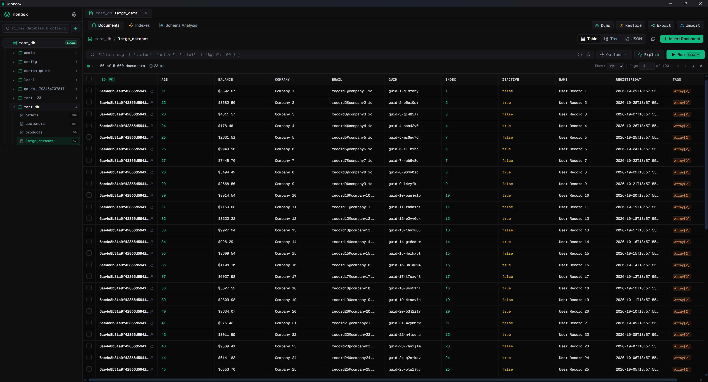

<div align="center">

# Mongox

**A high-performance, lightweight, and modern desktop administration client for MongoDB.**

Built with **Tauri v2**, **Rust**, **React 19**, **TypeScript**, and **Tailwind CSS**.

[](LICENSE)
[](https://tauri.app)
[](https://www.rust-lang.org)
[](https://react.dev)
[](https://www.typescriptlang.org)
[](https://www.mongodb.com)

<br />



</div>

<br />

## Highlights

- **Linear-Inspired Dark Interface**: Crafted with an ultra-clean `#08090A` dark palette, refined hairline borders, subtle elevation, and crisp typographic hierarchy.
- **Ultra-Lightweight & Fast**: Powered by a native Rust backend via Tauri v2. Cold launch completes in under 200ms with memory footprint below 50MB.
- **Object Explorer & Multi-Tab Workspace**: Navigate servers, databases, and collections in a consolidated hierarchical sidebar. Open multiple collections simultaneously into dedicated tabs for smooth parallel investigation.
- **Versatile Document Explorer**:
  - **Virtualized Table View**: Scroll smoothly across 5,000+ records with frozen `_id` and selection checkboxes.
  - **In-Place Inline Editing**: Double-click any table cell to edit values inline with instant save/cancel triggers and persistent database updates.
  - **Column Sorting**: Click column headers to sort documents in real time.
  - **Multi-Record Batch Actions**: Select multiple records with page or all checkboxes to copy IDs, copy raw JSON, or delete selected records.
  - **Tree View & Raw JSON**: Full hierarchical tree navigation and raw JSON editor with free native text selection.
  - **Visual Explain Plan**: Inspect index usage, stage steps (`COLLSCAN`, `IXSCAN`, `FETCH`), and execution timings.
- **Action Modals & Ergonomics**:
  - **Database Dump & Backup**: Parameterized `mongodump` wrappers supporting single archive generation, gzip compression, and custom arguments.
  - **Database Restore**: Intelligent `mongorestore` integration with deep BSON header inspection to automatically remap collection namespaces (`--nsFrom` / `--nsTo`) when restoring archives into new database names.
  - **Export Wizard**: Export collection data to JSON, NDJSON, or CSV with selective field filtering and built-in privacy masking (Email, Phone, SHA-256 hash, Redaction).
  - **Import Wizard**: Import data from CSV, JSON, or NDJSON with conflict handling (`upsert`, `insert`, `merge`) and empty field handling.
  - **MongoDB User & Role Management**: Inspect and manage database users and grant built-in or custom administrative roles.
- **Zero-Setup Auto-Provisioning**: Automatically resolves native OS binaries for `mongosh`, `mongodump`, `mongorestore`, `mongoexport`, and `mongoimport` directly into local application storage with progress tracking.
- **Production Safety Guards**: Critical database drops and collection trashing enforce typed name confirmations and strict protection prompts on production environments.

---

## Architecture Overview

```text
┌────────────────────────────────────────────────────────┐
│                   Mongox Frontend                      │
│        React 19 + TypeScript + Tailwind CSS            │
│    (Object Explorer, Virtualized Tables, Modals)       │
└───────────────────────────▲────────────────────────────┘
                            │ Tauri IPC (Commands & Events)
┌───────────────────────────▼────────────────────────────┐
│                  Tauri v2 Rust Core                    │
│  ├── Connection Manager & Profile Store                │
│  ├── Process Runner (Hidden Subprocess Orchestration)  │
│  ├── Tool Provisioner (Auto-Download / Verification)   │
│  ├── Backup & Restore Service (Namespace Remapping)    │
│  └── Export / Import Service (Data Masking Pipeline)   │
└───────────────────────────▲────────────────────────────┘
                            │ Subprocess Pipes / TCP Socket
┌───────────────────────────▼────────────────────────────┐
│                    MongoDB Server                      │
│           Local / Remote / MongoDB Atlas               │
└────────────────────────────────────────────────────────┘
```

---

## Installation & Releases

Pre-compiled installers are automatically built and published for each release across Windows, macOS, and Linux:

| Platform | Installer Format | Architecture |
| :--- | :--- | :--- |
| **Windows** | `.msi` (WiX) / `.exe` (NSIS) | x64 |
| **macOS** | `.dmg` / `.app` | Apple Silicon (M1/M2/M3/M4) |
| **Linux (Ubuntu / Debian / RPM)** | `.deb` / `.AppImage` / `.rpm` | x64 |

Download the latest installer from the official [Releases](https://github.com/nguyenduclong-ict/mongox/releases) page.

### First-Time Launch & Security Prompts

Because Mongox is an open-source community application distributed outside platform app stores without a paid commercial certificate, your operating system may display a security prompt during first launch:

#### macOS ("Mongox is damaged and can't be opened")
macOS Gatekeeper attaches a quarantine flag to files downloaded directly from the internet. To launch Mongox:
1. Drag `Mongox.app` into your `/Applications` directory.
2. Open **Terminal** and run (specify Apple's native binary path):
   ```bash
   sudo /usr/bin/xattr -cr /Applications/Mongox.app
   ```
   *Note: If you have Python or Homebrew's `xattr` installed, use `/usr/bin/xattr` explicitly or run:*
   ```bash
   xattr -d com.apple.quarantine /Applications/Mongox.app
   ```
3. Open Mongox from your Applications folder.

*GUI Alternative*: Go to **System Settings** > **Privacy & Security**, scroll down to the **Security** section, and click **Open Anyway** next to the Mongox prompt.

#### Windows ("Windows protected your PC")
Windows SmartScreen displays an informational dialog for newly published applications that have not yet accumulated download reputation:
1. Click **More info**.
2. Click **Run anyway**.

#### Linux
- **Debian / Ubuntu (.deb)**:
  ```bash
  sudo dpkg -i Mongox_*_amd64.deb
  ```
- **Universal AppImage**:
  ```bash
  chmod +x Mongox_*_amd64.AppImage
  ./Mongox_*_amd64.AppImage
  ```

---

## Building from Source

### Prerequisites

Ensure you have installed:
1. **Node.js** (v20.x or higher) and **npm**
2. **Rust** toolchain (stable, 1.77+):
   ```bash
   curl --proto '=https' --tlsv1.2 -sSf https://sh.rustup.rs | sh
   ```
3. **Platform Build Tools**:
   - **Windows**: Microsoft C++ Build Tools (Visual Studio 2022 C++ workload)
   - **macOS**: Xcode Command Line Tools (`xcode-select --install`)
   - **Linux**: `libwebkit2gtk-4.1-dev`, `build-essential`, `curl`, `wget`, `file`, `libssl-dev`, `libgtk-3-dev`, `libayatana-appindicator3-dev`, `librsvg2-dev`

### Development Setup

1. **Clone the repository**:
   ```bash
   git clone https://github.com/nguyenduclong-ict/mongox.git
   cd mongox
   ```

2. **Install frontend dependencies**:
   ```bash
   npm install
   ```

3. **Start development mode with web live-reload**:
   ```bash
   npm run dev
   ```

4. **Launch the desktop application via Tauri**:
   ```bash
   npm run tauri dev
   ```

### Building Production Installers

To package native platform installers (`.msi`, `.exe`, `.dmg`, `.deb`, `.AppImage`):

```bash
npm run tauri build
```

Generated bundles are placed in `src-tauri/target/release/bundle/`.

---

## Testing & Quality Gates

Mongox follows an automated testing approach with full end-to-end integration against live MongoDB:

```bash
# Run Rust unit and integration tests (21 tests)
cargo test --manifest-path src-tauri/Cargo.toml

# Build frontend assets and run full Playwright E2E suite (33 tests against live MongoDB)
npm run build
npx playwright test
```

---

## Documentation

Full architectural and product documentation is available in the [`docs/`](docs/) directory:

- [System Architecture & Design Decisions](docs/architecture/system-overview.md)
- [Linear Design System Standards](docs/architecture/decisions/0003-linear-design-system.md)
- [Zero-Setup Auto-Provisioning](docs/specifications/features/auto-provisioning/spec.md)
- [Backup & Restore Hub Specification](docs/specifications/features/backup-restore/spec.md)
- [Export & Import Wizard Specification](docs/specifications/features/export-import/spec.md)
- [Playwright E2E Test Strategy](docs/engineering/playwright-test-plan.md)

---

## License

This project is licensed under the [MIT License](LICENSE).
